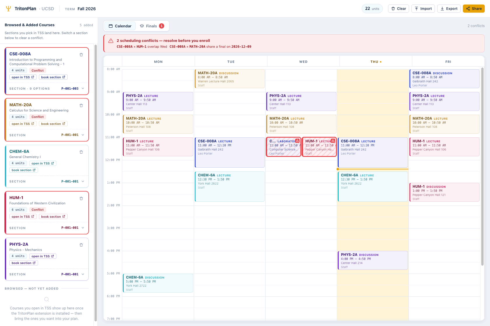
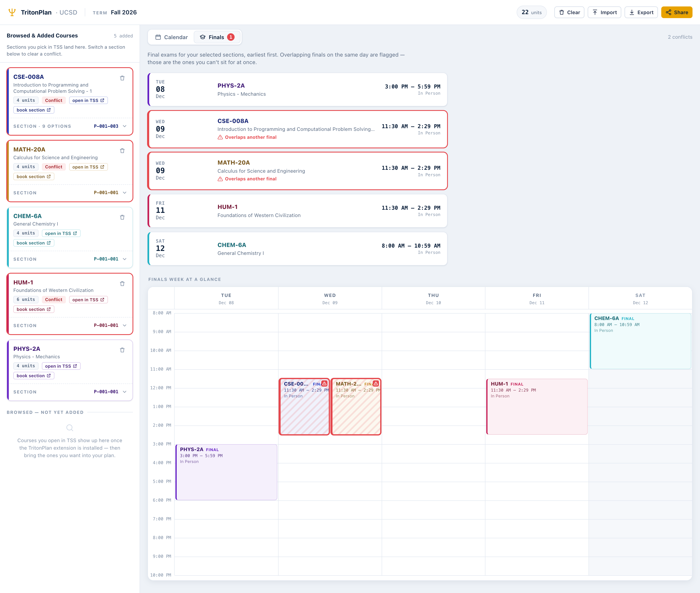
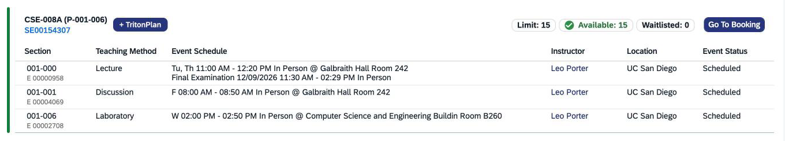
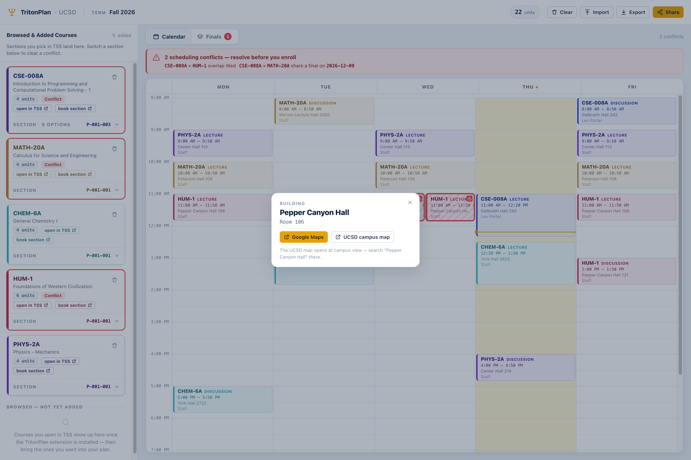

**English** | [中文](./README.zh-CN.md)

# TritonPlan

**A calendar-first course planner for UC San Diego — the WebReg "plan" view that the new Triton Student System (TSS) never shipped.**

**➡️ Open the planner: <https://tritonplan.cn>**
**➡️ Install the extension: [Chrome Web Store](https://chromewebstore.google.com/detail/tritonplan/lnchlccmjhhpbbemlfnpldooeehcmjel)**

The old WebReg showed your week as a calendar — times, locations, professors, sections, final exams — and flagged time conflicts before you enrolled. TSS doesn't. TritonPlan rebuilds that view:

1. **A Chrome / Edge extension** that passively reads the course data TSS already displays to you and puts a **"+ TritonPlan"** button on each bookable section.
2. **A planner website** that draws your week as a calendar and flags conflicts. Sign in and your plans are saved to your account, so they follow you across devices.

> **Unofficial, student-made tool.** Not affiliated with, authorized, or endorsed by UC San Diego. See [Disclaimer](#disclaimer) and [PRIVACY.md](./PRIVACY.md).

---

## Features

- **Weekly calendar grid** — every lecture, discussion, and lab laid out by day and time, with a live "now" line on today.
- **Time-conflict detection** — overlapping meetings light up so clashes are visible at a glance.
- **Finals view** — your final exams in date order plus a finals-week calendar (weekends included), with its own overlap detection.
- **Section switching** — compare a course's lecture/discussion/lab combinations (tagged LEC / DIS / LAB, with seat counts) and switch right in the planner to clear a conflict.
- **Jump back to TSS** — click a course code on the calendar to return to that exact course in TSS, or jump straight to the section's booking page.
- **Building lookup** — click a class's location to see which building it is, with Google Maps and UCSD campus map links.
- **Your appointment times** — the "My Appointment Times" windows (First Pass, Second Pass, …) captured from TSS show as a live capsule in the planner topbar, so you always know when you can enroll. Private: never part of shared plans.
- **Share** — send a short link and whoever has it sees a snapshot of that plan. The snapshot is stored on our server; turn any link off under **Shared links** in the Account menu.
- **Calendar subscription** — subscribe in Apple or Google Calendar to a private link that shows your classes, rooms and finals. Anyone with the link can see them; reset it any time.
- **Professor ratings** — RateMyProfessors ratings on every course card. Only instructor names go to our server; nothing about you goes to RMP.
- **Accounts** — sign in with email + password or Google; your plans are stored on our server, not just in one browser.

## Screenshots

---

## How it works: capturing the OData the server already sends you

TSS is an SAP (SAPUI5 / Fiori) web app. When you browse the Schedule of Classes, the TSS server sends your browser the course data as **OData** (JSON) responses, and the page renders them on screen.

That's all TritonPlan needs. The extension **captures those responses as they arrive in your browser** — a copy of data the server already sent *you* — parses the schedules out of them, and hands the result to the planner page in your browser, which saves it to your account. It never asks the TSS server for anything.

This passive design is the product's hard rule:

- **Zero requests of its own.** The extension only observes responses the TSS page itself fetched (`response.clone()` on the page's own `fetch`/`XHR`). It never issues, replays, retries, prefetches, or polls.
- **Zero automation.** It never clicks TSS buttons or submits anything on your behalf.
- **Indistinguishable traffic.** Because it adds nothing, your traffic is byte-for-byte identical to any other student's.
- **Minimal permissions.** `storage` and `tabs`, plus host access to `tss.ucsd.edu` and the planner site only. No analytics, no tracking.

---

## How to use

1. **[Install the extension](https://chromewebstore.google.com/detail/tritonplan/lnchlccmjhhpbbemlfnpldooeehcmjel)** (works in Edge too — it installs straight from the Chrome Web Store).
2. Browse the **Schedule of Classes** in TSS as usual.
3. Click **"+ TritonPlan"** on a section you want — you land on the planner with it placed.
4. Arrange sections to avoid conflicts, and check the **Finals** view.
5. **Share** your plan.

Manual install (load unpacked)

1. Build from source: `npm install && npm run build -w @triton/extension` → `extension/dist`.
2. Open `chrome://extensions`, enable **Developer mode**, click **Load unpacked**, select `extension/dist`.

**Platforms:** the extension runs on Chrome and Edge (MV3) on any OS; the planner site works in any modern browser.

---

## Privacy

You sign in with email + password or Google. We store your email (and Google account ID if you use Google sign-in), your plans, the courses you browsed, your booked / waitlisted / enrolled marks, and your appointment times on one server (Tencent Cloud, Silicon Valley, USA). Never sold, no ads, no analytics, no third-party trackers. Delete your account from the Account menu at any time. Share links and your calendar link are stored on the server too (anyone holding one can see what it points to; both are deleted with your account). Ratings come from a monthly copy of RateMyProfessors' public UCSD list, so nothing about you is sent to RMP. The extension still only reads what the TSS page already received and sends no requests to TSS. Full details: [PRIVACY.md](./PRIVACY.md) or <https://tritonplan.cn/privacy.html>.

## Developing

Monorepo: `shared/` (data model + conflict logic), `web/` (React planner), `extension/` (MV3). Setup, commands, and architecture: [docs/development.md](./docs/development.md).

## Credits

Built with the help of **Claude AI** — Anthropic's **Claude Code**.

## Disclaimer

TritonPlan is an **unofficial, student-made tool**, not affiliated with, authorized, or endorsed by UC San Diego. It only reads course data already displayed in your own browser; the planner stores your plans in your account on our server (see [PRIVACY.md](./PRIVACY.md)). Provided **as-is, with no warranty — use at your own risk**. You are responsible for using it in accordance with UCSD's Acceptable Use Policy and all applicable UCSD policies.

## License

MIT — see the `license` field in [`package.json`](./package.json).
